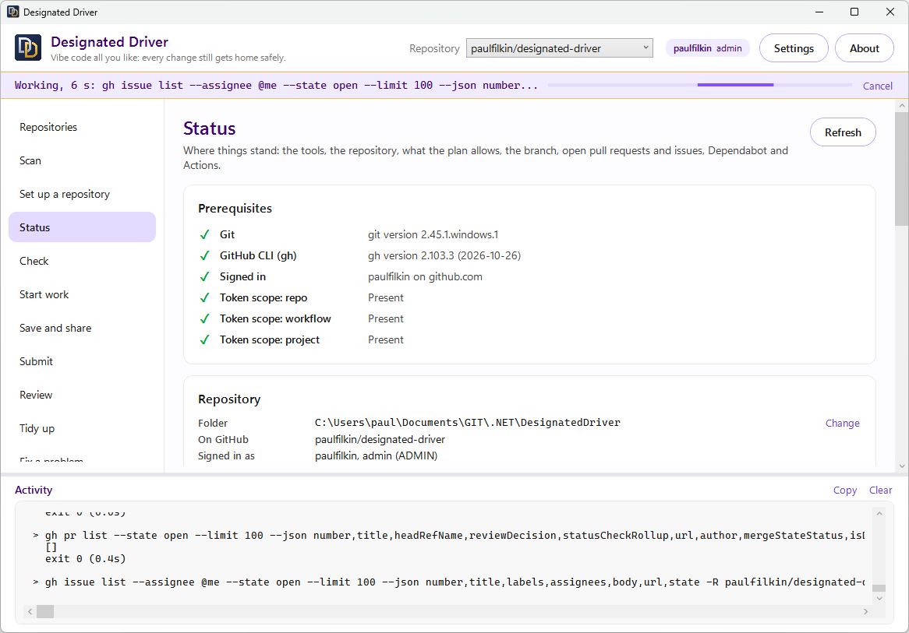

<p align="center">
  
</p>

<h1 align="center">Designated Driver</h1>

<p align="center">
  <strong>The one who stays sober while the AI vibes, and gets everyone home safely.</strong>
</p>

<p align="center">
  A Windows desktop app that keeps your GitHub repositories to one convention<br>
  and walks every change from issue to merge.
</p>

<p align="center">
  <a href="https://github.com/paulfilkin/designated-driver/releases/latest">Download</a> ·
  <a href="Docs/Getting%20started.md">Getting started</a> ·
  <a href="Docs/Designated%20Driver%20TDD.md">Design</a> ·
  <a href="CONTRIBUTING.md">Contributing</a>
</p>

## Why

Building software with an AI coding assistant is fast.  It is also easy to end up with commits straight on `main`, branches nobody remembers, pull requests that close nothing, and a project board that no longer matches the code.

Many people building this way have never run a project on GitHub, and nobody has shown them how issues, branches, reviews and releases fit together.  Invite someone else to work on it with you, and the gaps show at once: who is working on what, which change is ready, and what is safe to merge.

Designated Driver puts those controls in place and keeps them there.  Every change starts as an issue, happens on a branch named for it, arrives through a pull request that closes it, passes its checks, and is tidied away afterwards.  The rules hold for everyone who works on the repository, not only you: the board shows who is doing what, the required check and the review stop unfinished work reaching `main`, and the guides show a newcomer how it all works.  You and your assistant do the work; the app makes sure it gets home.

## What it does

- **Sets a repository up in one go.**  A new repository, a folder on your machine, or one already on GitHub: labels, a project board, issue forms, a pull request template, CI with a required check, a guard workflow, local Git hooks and Dependabot, plus a ruleset, push protection and CodeQL on public repositories.  You see the whole plan before anything changes.
- **Keeps it there.**  Check compares a repository with the convention, file by file and setting by setting, shows what has drifted, and puts right what you tick.
- **Walks the daily workflow.**  Start work writes or picks an issue and makes its branch.  Save and share commits with the message checks and pushes.  Submit opens the pull request with its `Closes #n` line filled in.  Review merges.  Tidy up takes you back to `main`.
- **Ready for more than one person.**  Contributors get the same issue forms, branch names, checks and review as you, a contributing guide that says how changes get in, and a Git guide with the commands for each step.
- **Hides nothing.**  It runs `git` and `gh` and nothing else, and every command appears in the activity panel with its output.  No token is ever stored: the GitHub CLI holds your sign-in.
- **Works on the Free plan.**  Where GitHub offers no ruleset, as on a private repository on the Free plan, local hooks and the guard workflow stand in for it.  Public repositories get GitHub's own protection on top.

## What a repository gets

| | |
|---|---|
| Labels | `bug`, `feature`, `docs`, `chore`, `question`, `good first issue`, `blocked` and `wontfix` |
| A project board | GitHub's Todo, In Progress and Done columns, moved by GitHub's own automations |
| Issue forms | Bug and feature, so every issue arrives with the facts it needs |
| Pull request template | The `Closes #n` line and a checklist |
| CI | Builds and tests every pull request as the required **Build and test** check |
| Guard | Fails a pull request with no `Closes` line, a branch name outside the convention, or a branch too far behind; opens an issue if something is pushed straight to `main` |
| Local hooks | `commit-msg` checks the message; `pre-push` refuses a push to `main` |
| Dependabot | Security alerts and weekly version updates |
| Contributing guide and Git guide | How changes are made here, and the commands for each step |
| On public repositories | A ruleset on `main`, secret scanning push protection, and CodeQL |
| On .NET projects | A release workflow that publishes a single-file exe when you push a version tag |

A manifest in `.github` records what was set up, so Check knows what to compare, and a second machine needs nothing but the folder.

## The screens

<p align="center">
  
</p>

| Screen | What it does |
|---|---|
| Repositories | The repositories the app knows; filter by text or by your GitHub stars |
| Scan | A read-only look at any folder or repository against the convention, ending with the next step |
| Set up a repository | The wizard, for a new repository or an existing one |
| Status | The tools, the repository, the branch, open pull requests and issues, Dependabot alerts and Actions minutes |
| Check | What has drifted from the convention; tick and apply |
| Start work | Write a new issue or pick one from the board, assign it to yourself, make the branch |
| Save and share | Commit with the message checks, and push |
| Submit | Bring the branch up to date, open the pull request, watch the checks |
| Review | Approve, request changes, merge |
| Tidy up | Back to `main`, pull, delete merged branches |
| Fix a problem | The common situations, each with its commands |

## Getting started

You need Windows 10 or 11, the [.NET 10 desktop runtime](https://dotnet.microsoft.com/download/dotnet/10.0), Git and the GitHub CLI, and a GitHub account:

```powershell
winget install Git.Git GitHub.cli
```

```powershell
gh auth login
```

1. Download the zip from the [latest release](https://github.com/paulfilkin/designated-driver/releases/latest), unzip it and run `DesignatedDriver.exe`.  There is nothing to install.
2. Status lists what the app needs and gives the command for anything missing.
3. Press **Set up a repository**, choose where the repository comes from, read the plan, and press Start.
4. From then on: Start work, Save and share, Submit, Review, Tidy up.

[Getting started](Docs/Getting%20started.md) covers the first hour in more detail, including SSH aliases for machines with more than one GitHub account, and the board token.

## From a terminal

Four switches run without the window, printing every command as they go:

| Switch | What it does |
|---|---|
| `--scan <folder or owner/name>` | Reports what setting the repository up would involve |
| `--setup <answers.json>` | Runs the set-up plan from an answers file |
| `--check <folder> [--apply [--all]]` | Reports what has drifted from the convention, and puts it right |
| `--self-test` | Runs the built-in checks and prints PASS or FAIL for each |

## Building from source

You need the .NET 10 SDK.  There are no NuGet packages.

```powershell
git clone https://github.com/paulfilkin/designated-driver.git
```

```powershell
cd designated-driver
```

```powershell
dotnet run --project DesignatedDriver\DesignatedDriver.csproj
```

```powershell
dotnet run --project DesignatedDriver\DesignatedDriver.csproj -- --self-test
```

The project is `DesignatedDriver\`.  Inside it, `Core\` holds the logic with no process or file access, `Convention\` the files the convention writes, `Services\` the Git and GitHub work, `Screens\` and `Windows\` the interface, and `SelfTest\` the checks and the sample `gh` output they run against.

## Status

Designated Driver is at version 0.x and in daily use on its own repository, which it set up itself.  It runs on Windows only, and is built for repositories on a personal GitHub account.  Bugs and ideas are welcome as [issues](https://github.com/paulfilkin/designated-driver/issues/new/choose).

## Documentation

- [Getting started](Docs/Getting%20started.md): what you need, signing in, the first repository, the screens, the board, the switches.
- [Working with Git](Docs/Working%20with%20Git.md): the commands for each step of a change, for someone new to Git.
- [The design](Docs/Designated%20Driver%20TDD.md): the technical design, and what was built from it.
- [Contributing](CONTRIBUTING.md): how changes get in.

## Licence

[MIT](LICENSE).  Copyright © 2026 multifarious.
